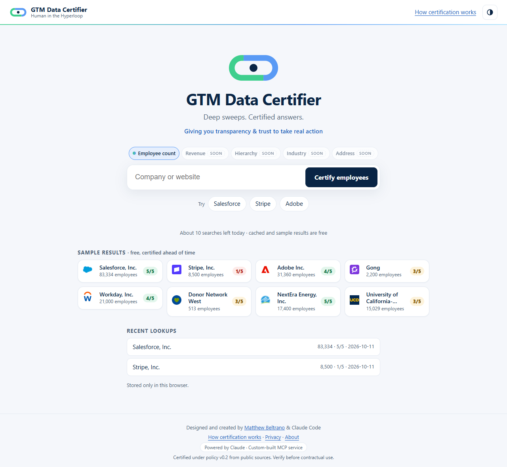
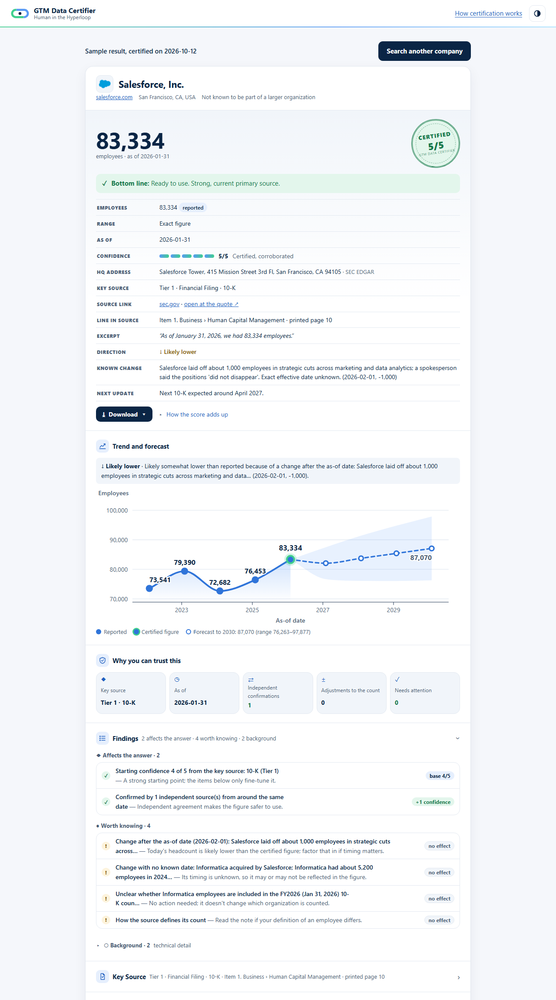

# GTM Data Certifier

**Deep sweeps. Certified answers.** *Giving you transparency & trust to take real action.*

A Human in the Hyperloop project. Designed and created by [Matthew Beltrano](https://www.linkedin.com/in/matthewbeltrano/) and Claude Code.



---

## The 30,000-foot view

### The problem

Go-to-market teams run on company data: employee counts drive segmentation, territory design, account scoring,
routing, pricing tiers and total addressable market. Most teams buy that data from large enterprise providers such as
ZoomInfo or Dun & Bradstreet, or assemble it with enrichment tools such as Clay.

Those sources give you **a lot of data, but very little transparency**:

- **Where did this number come from?** Usually you see a value, not the document behind it.
- **When was it true?** A headcount from an annual report two years ago and one from last month look identical in a CRM
  field.
- **How much should I trust it?** There's rarely a consistent, explainable confidence measure tied to the actual
  evidence.

So the data can't be used with confidence. RevOps teams end up double-checking, spot-auditing and writing filter rules
to keep questionable values out of the CRM. That's slow, expensive, and still leaves you unsure.

Enrichment "waterfalls" add coverage, but not judgment. A waterfall tries provider A, then provider B, then provider C,
and takes the first answer it gets. The order is a configuration choice, not a quality policy, so a filled field tells
you that *some* provider answered, not that the *best available* evidence was used.

### What GTM Data Certifier does

GTM Data Certifier finds the **most authoritative public figure** for an organization's employee count, shows **exactly
where it came from**, down to the document, section and page, and scores **how far you can rely on it**, on a 0–5
scale with the reasons spelled out.

It sweeps deep and wide on purpose: official filings, government registries, the company's own publications, its
website and LinkedIn profile, reputable news, and data providers. It then applies a **written, consistent policy** to
choose the best source, rather than whichever responded first.

The result isn't just a number. It's a number you can **judge against your own standards** and **defend** when you act
on it, whether that's updating a CRM record, setting a territory, or answering "where did that come from?"

> **In one line:** other tools tell you *what* the number is. GTM Data Certifier also tells you *where it came from*,
> *when it was true*, *how confident to be*, and *why*, so you can decide whether it's good enough for your use case.

---

## The 10,000-foot view

### How a certification works

1. **You name a company.** Type a name or website and confirm which organization you mean, for example a parent
   company versus a regional subsidiary.
2. **Deep sweep.** The certifier reads official sources directly (SEC filings, nonprofit tax returns, university
   staffing reports) and uses Claude, an AI model by Anthropic, to search the wider web. Every figure it finds is recorded with
   its exact quote, date, and where it appears.
3. **Policy-based selection.** A fixed, written policy, not the AI, ranks every source and picks the best one. Higher
   tiers win, newer figures beat older ones, and copies of the same number don't count as independent confirmation.
4. **Confidence score.** The chosen figure gets a 0–5 score built from transparent steps (for example "base 4: annual
   report; +1: confirmed by an independent source"), each linked to the evidence behind it.
5. **A decision-ready result.** You see the answer, a one-line bottom line, the source and the exact quote, a trend
   with a forecast, and every finding that affected the score.

The same evidence always produces the same answer. The AI gathers and reads the sources; the rules that decide are
ordinary, tested code.

### The source hierarchy: why some numbers beat others

| Tier | What it is | Examples |
| --- | --- | --- |
| 1 | Annual financial filings | 10-K, 20-F, 40-F; a government's audited annual financial report (ACFR) |
| 2 | Official company and registry reports | Corporate Fact Sheet, nonprofit IRS Form 990, university IPEDS staffing report |
| 3 | Company publications | Press releases, other company documents |
| 4 | Company website | The About page or other pages |
| 5 | Company social profile | The headcount the company states in its LinkedIn description |
| 6 | News quoting an executive | A reputable outlet quoting a named executive |
| 7–8 | Data providers and specialty data | ZoomInfo, Revelio Labs, PitchBook, Crunchbase |
| 9 | Everything else | Aggregators, directories, encyclopedias: supporting evidence only |

Every source on a result is labelled with its tier, a plain category and its exact type, for example
**Tier 1 · Financial Filing · 10-K**, with a "What is this?" explanation one click away.

### The confidence scale: what each score means for you

| Score | Label | Bottom line shown | Typical evidence |
| --- | --- | --- | --- |
| 5 | Certified, corroborated | **Ready to use.** Strong, current primary source. | A recent official filing, confirmed by an independent source |
| 4 | Certified | **Ready to use.** | A recent official filing |
| 3 | Supported | **Usable.** Note the range and the as-of date. | An older filing, or a company statement others back up |
| 2 | Estimated | **Directional only.** Verify before updating records. | A company statement on its own, or consistent data-provider estimates |
| 1 | Unverified | **Directional only.** | Thin, old or conflicting evidence |
| 0 | Unattained | No certified figure. | Nothing usable found |

**How to use the score:** decide your bar per use case. You might auto-update CRM records at 4–5, review 3 by hand,
and treat 0–2 as directional only. The certifier gives you what you need to apply that rule consistently.



---

## Reading a result

From top to bottom:

1. **The answer:** the employee count, a confidence stamp, and a **bottom line** telling you whether it's ready to use.
2. **Facts table:**
   - employees, range, as-of date and confidence
   - the key source: tier, category and type
   - a **link to the source** that opens at the exact quote, and the **line in the source** (section and page)
   - a short **excerpt**
   - the likely **direction** since the as-of date (higher, lower or in line)
   - any known changes, such as layoffs announced after the filing
   - when the **next update** is expected, for example the next 10-K
3. **Download ▾:** Copy for CRM (a clean block with count, as-of date, confidence, source and URL, and a one-line
   rationale), slides, a document and data files.
4. **Trend and forecast:** up to five reported years from the same kind of source, plus a four-year forecast with a
   widening range. Forecasts are always marked as estimates.
5. **Why you can trust this:** key source, as-of date, independent confirmations, adjustments to the count, and items
   needing attention, each one click from its detail.
6. **Findings:** a one-line log in three groups:
   - **Affects the answer:** changed the number or the confidence, with the exact effect ("−1 confidence")
   - **Worth knowing:** context with no effect on the answer
   - **Background:** technical detail, collapsed

   Every finding has a plain-English **"so what"** telling you whether to act.
7. **Key source, sources, adjustments, events:** the full evidence: every source found, used or excluded and why, with
   the detailed passage and location.
8. **Download** (top and bottom of the card, and in Claude): Copy for CRM, a **4-slide PowerPoint** (light or dark, in the brand), a **Word document** with the full supporting detail, a summary CSV, a sources CSV, and JSON (the full certification record).

---

## Ground level: the mechanics

### What gets read, and how

- **SEC EDGAR:** the five most recent annual filings (10-K, 20-F, 40-F), read directly. The quote is located in the
  filing by page break and footer, so the result can say "Item 1. Business › Human Capital, printed page 10".
- **IRS Form 990 (nonprofits):** five years of Part I, line 5 (total employees), via ProPublica's Nonprofit Explorer.
- **IPEDS (U.S. colleges and universities):** "Total all staff (excludes graduate assistants)" from the U.S. Department
  of Education's institution profile, with graduate assistants recorded separately and not added.
- **Company website:** About-page statistics, read as "Label: value" pairs.
- **The wider web:** Claude searches for annual reports, fact sheets, press releases, the LinkedIn profile, executive
  quotes in the news, data providers, and prior years' figures for the trend. It reports evidence only; it never picks
  the answer.

### Rules worth knowing (all in [policy.yaml](policy.yaml) and [SPEC.md](SPEC.md))

- **Recency.**
  - Figures older than 18 months lose a point.
  - Figures older than 24 months are supporting evidence only.
  - The latest IPEDS release counts as current until the next one is due, because it is always published about a year
    behind.
- **Corroboration** must be independent and from around the same date. Restatements (an aggregator quoting the 10-K)
  and prior years don't count.
- **Exact beats rounded** when they agree: a detailed figure in an annual report beats "more than 110,000" in the
  filing summary.
- **Scope matters.** A figure for one region, segment or subsidiary is never used as the whole-company count.
- **One root cause, one penalty.** If LinkedIn shows more people because of an affiliated health system that's already
  flagged, it isn't penalized twice.
- **Known changes are labelled, not invented.** If layoffs were announced after the as-of date, the result says the
  current count is likely lower and why; it doesn't publish a number no source stated.
- **LinkedIn is a sanity check, never the answer.** A member count far from the certified figure is flagged.

### Using it

- **On the web:** search, confirm the organization, watch the expedition (about 30–90 seconds for a new lookup), then
  read the result. Eight **sample results** on the home page open instantly.
- **In Claude:** add the certifier as a custom connector (About → "Use it in Claude"), then ask "What's the certified
  employee count for Adobe?" Claude confirms the company and shows the same card in the chat.

### Open beta limits

- No sign-up. Each visitor has about **10 new lookups a day**, and the whole service has a daily cap. Both reset at
  midnight Pacific.
- **Cached results (shared for 90 days) and the sample results are always free.** **Refresh** runs a new lookup.
- Privacy: the IP address is never stored. It's hashed with a salt that changes daily, and used only for these
  limits. Searches, results and ratings are kept for quality review.

---

## For technical readers

The repository is a Python 3.12 service (FastAPI, the MCP Python SDK, the Anthropic SDK, SQLite).

| Document | What's in it |
| --- | --- |
| [SPEC.md](SPEC.md) | The full certification policy, the record format, the hosted experience |
| [policy.yaml](policy.yaml) | Every tunable value: tiers, recency windows, thresholds, budgets, research guidelines |
| [source_glossary.yaml](source_glossary.yaml) | The "What is this?" explanation for each source type (editable, no code changes) |
| [DECISIONS.md](DECISIONS.md) | Every design and policy decision, with the reasoning and alternatives |
| [DEPLOY.md](DEPLOY.md) | Step-by-step Render deployment, environment variables, beta limits, troubleshooting |
| [FEEDBACK.md](FEEDBACK.md) | Review feedback and the backlog |
| [docs/screenshots/](docs/screenshots/) | Every screen, light and dark, desktop and phone |

### Run it locally

1. Install [uv](https://docs.astral.sh/uv/) and Python 3.12.
2. Create `.env` in the repo root (it's gitignored):
   ```
   ANTHROPIC_API_KEY=sk-ant-...
   SEC_USER_AGENT=Your Name your.email@example.com
   ```
3. Install: `uv sync`
4. Web app: `PUBLIC_BASE_URL=http://localhost:8000 uv run uvicorn certifier.web:app --port 8000`
   (add `CERTIFIER_DEMO=1` for the `?demo=…` screenshot views)

**Claude Desktop (local, no limits):** add this to `claude_desktop_config.json` (on Windows: `%APPDATA%\Claude\`) and
restart Claude Desktop:

```json
{
  "mcpServers": {
    "employee-count-certifier": {
      "command": "uv",
      "args": ["--directory", "C:\\path\\to\\employee-count-certifier", "run", "certifier-mcp"]
    }
  }
}
```

### Code map

| Path | Role |
| --- | --- |
| `src/certifier/service.py` | One lookup end to end: entity, filings, research, scoring |
| `src/certifier/engine.py`, `rules.py` | The deterministic policy: selection, recency, corroboration, flags, score |
| `src/certifier/research.py`, `llm.py` | Claude research and structured extraction, with spend tracking |
| `src/certifier/sources/` | Readers for SEC EDGAR, ProPublica (Form 990), IPEDS, company websites |
| `src/certifier/record.py`, `taxonomy.py` | The certification record (v1.2), findings, source labels |
| `src/certifier/card.py`, `static/` | The result card (shared by web, saved files and Claude) and the web app |
| `src/certifier/web.py`, `hosted.py`, `server.py` | Web API, open-beta allowances, MCP server for Claude |
| `samples/` | The pre-certified sample results |

### Tests

```
uv run pytest                                      # offline suite (no API calls)
RUN_LIVE=1 uv run pytest tests/test_live_edgar.py  # live SEC EDGAR golden set
RUN_LIVE=1 uv run pytest tests/test_live_schema.py # live check before changing extraction schemas
```

A new lookup typically costs $0.10–0.25 in Anthropic API usage. Worked examples live in `examples/`, one YAML file
per case, and each one is also a regression test.
